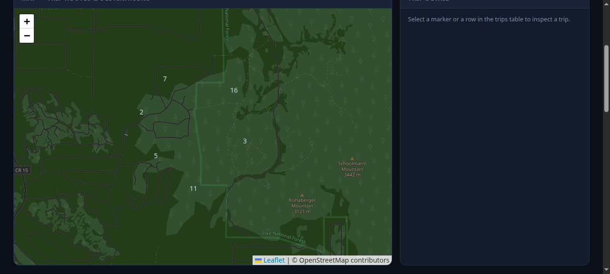

# automaticVisualizer

Back in high school I had an Automatic Pro installed in my 2000 Ford Explorer
— the family car my dad handed down, the one my family had been in as long
as I can remember. It just quietly logged every trip I ever made — where I went, how hard I
braked, how many minutes I spent over 80 — and pushed each export up to a Google
Drive folder. I forgot about it.

Years later, after I'd picked up Python and the rest of the data-processing
toolkit, I found that folder again. About eighteen months of *me*, in
spreadsheets. I'd installed it for fuel consumption and total miles — but
the thing that kept me reading was the other half: where I'd actually gone,
and how often I'd kept going there. So I built a dashboard for that.

What you're looking at is that dashboard, running on **synthetic sample
data**. The real trips stay in that Drive folder; this repo ships a seeded,
reproducible 44-trip set (fake towns, no header row, real Automatic Pro
schema) so the same code you read here is the code that runs against the
real thing.

## What it shows

- A Leaflet map of every trip as a polyline — colored by MPG, cluster
  markers, click-through to a single trip you can zoom into.
- KPI cards for the filtered set: distance, MPG, fuel, cost, hard-event
  counts.
- Three Chart.js bar charts: destination category, miles by month, MPG
  distribution.
- A detail panel (one trip at a time) with the destination as a live Google
  Maps link.
- Filters: date range, destination category, destination search.




Two things about the Automatic Pro export were worth the trouble, and the
code is mostly what deals with them:

1. **No header row.** The sheet is 20 raw columns; the order *is* the format.
2. **The route hides in a Google Maps URL.** Each trip's `map_url` carries
   the route as an *encoded* polyline (`path=enc:...`) that the app regexes
   out and decodes; anything over 100 points gets decimated so the map
   stays light.

### The 20 columns (0-indexed)

| # | column | notes |
|---|--------|-------|
| 0 | vehicle | |
| 1 | started_at | text, e.g. `July 28, 2017 at 01:52PM` |
| 2 | ended_at | same format; may equal `started_at` |
| 3 | distance | miles |
| 4 | duration | fraction of a day **or** `HH:MM` — both appear in real exports, the app handles both |
| 5 | mpg | |
| 6 | fuel_cost | |
| 7 | fuel_used | |
| 8 | hard_acc | count |
| 9 | hard_brakes | count |
| 10 | over_70 | count |
| 11 | over_75 | count |
| 12 | over_80 | count |
| 13 | map_url | Google Maps URL; contains `path=enc:...` for the route |
| 14 | start_lng | |
| 15 | start_lat | |
| 16 | start_link | |
| 17 | end_lng | |
| 18 | end_lat | |
| 19 | end_link | |

## Run it

```bash
cd automaticVisualizer
pip install -r requirements.txt
flask --app app:app run
# → http://127.0.0.1:5000
```

No database, no build step — the `.xlsx` files *are* the data store. The app
looks for exactly two filenames, `Automatic Pro Trips.xlsx` and
`Automatic Pro Trips (1).xlsx`, in the working directory (the `DATA_FILES`
list at the top of `app.py`). Honest footnote: it's built around the names
Automatic Pro gives its exports, and "renaming" is a code edit, not a config
option. A renamed export sitting there just silently won't load.

`places_cache.json` maps a coordinate to `{label, category}`. It's optional —
the dashboard falls back to "Unknown" — but without it the category chart
goes flat and the destination filters lose their names. Regenerate it with
`geocode.py` (needs a Geoapify key in `.env`; there's a `.env.example`).

## API

| route | returns |
|-------|---------|
| `GET /` | the dashboard HTML |
| `GET /api/trips` | JSON array, one object per trip |
| `GET /api/meta` | totals for the header |

`/api/trips` elements carry `start`/`end` (ISO), `dist`, `dur_min`, `mpg`,
`cost`, `fuel`, the hard-event counters, start/end coordinates, `end_link`
(a Google Maps view, surfaced in the detail panel), and `route` — a
`[[lat, lng], …]` list ready to throw at Leaflet.

## Files

- `app.py` — Flask: parses the xlsx, decodes the polylines, serves JSON.
- `templates/index.html` + `static/app.js` + `static/style.css` — the
  dashboard. Leaflet 1.9.4 + MarkerCluster 1.5.3 + Chart.js 4.4.1, all CDN,
  no bundler.
- `make_sample_data.py` — regenerates the 44-trip synthetic set from seed
  `2026`.
- `geocode.py` — standalone one-off that (re)builds the places cache via
  Geoapify.

Two footnotes. Tiles are stock OpenStreetMap with a CSS invert filter — my
first pass used CARTO dark tiles, which now quietly 401 without a paid key,
and I didn't want to buy API keys for a dashboard about a car I no longer
drive, so the invert is the fix that stuck. And the sample data is exactly
44 trips, 2018-01-03 → 2018-12-28; nothing in this repo is a real trip from a
real car.
